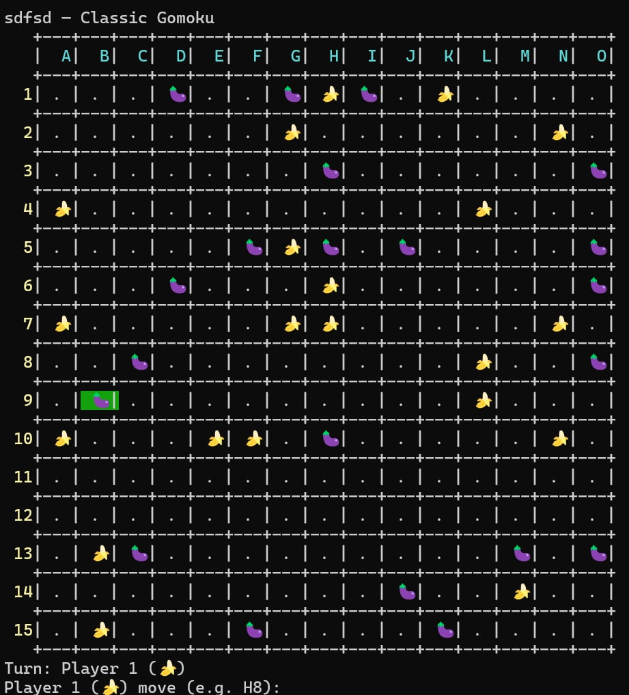

# Gomoku

A configurable Gomoku implementation with a reusable console menu, a shared game engine, JSON and EF Core persistence, and console and browser UIs.


## Run

From the repository root:

```powershell
dotnet build Gomoku.sln
dotnet test Tests\Tests.csproj
dotnet run --project ConsoleUI\ConsoleUI.csproj
dotnet run --project WebUI\WebUI.csproj
```

The browser UI is served at the URL printed by ASP.NET Core. Both UIs use the same repositories and saved-game format.

## Projects

- `MenuSystem`: game-agnostic menu items, shortcut validation, nested menus, and automatic navigation items.
- `GameEngine`: immutable game configurations, state, move validation, win/draw detection, and move providers. It has no console dependency.
- `DAL.Json`: JSON repositories implementing the engine's repository interfaces.
- `DAL.EF`: SQLite repositories implementing the same interfaces; the initial migration is applied on startup.
- `Persistence.Extensions`: dependency-injection registration and persistence selection.
- `ConsoleUI` and `WebUI`: separate front ends using the same engine and repositories.
- `Tests`: engine, menu, and shared JSON/EF repository contract tests.

## Rules and presets

Configurations define board width and height, winning length, horizontal cylinder wrapping, and overline behavior. To prevent unreasonable allocations, a board is limited to 10,000 cells:

- `AtLeast`: a line of the configured length or longer wins.
- `Exactly`: only a line whose full contiguous run has exactly the configured length wins.
- `WrapHorizontal`: the left and right edges connect; horizontal and diagonal lines may cross that edge.

The first run seeds Classic Gomoku, Cylinder Gomoku, Exact Five, and a compact test preset. Presets cannot be edited or deleted. Custom configurations can be created, listed, edited, and deleted; invalid dimensions and rule combinations are rejected before starting a game.

The console supports human-vs-human, human-vs-random-AI, random-AI-vs-random-AI, and human-vs-search-AI. Games autosave on creation and after every move. The browser UI supports creating configurations and games, making moves, and loading or deleting saved games.

Console moves use a column label and row number, such as `H8`; occupied or malformed moves do not consume a turn. The console displays X as 🍌 and O as 🍆, while the engine and saved data continue to use X/O. Use a modern UTF-8 terminal such as Windows Terminal or the VS Code integrated terminal for emoji rendering. Board cells are three terminal columns wide and one row high to appear roughly square with common terminal fonts. Press Ctrl+C to exit at any time; games are saved after every completed move.

The search AI uses depth-limited minimax with alpha-beta pruning, a line-window evaluation function, nearby legal-move selection, and a default 250 ms budget. The random provider remains available and accepts an injected seed for deterministic tests.

## Persistence

By default, both apps use JSON files below `%USERPROFILE%\.gomoku`. To switch both apps to SQLite, change `"Persistence": "Json"` to `"Persistence": "Db"` in both `ConsoleUI\appsettings.json` and `WebUI\appsettings.json`. The SQLite database is stored in the same user data directory and migrations run automatically. `DataDirectory` can be set to the same absolute path in both settings files when a different shared location is needed.

`MenuSystem` reserves shortcuts `0` for Exit, `9` for Return to previous menu, and `8` for Return to main menu. Menu items must use other shortcuts; the navigation items are added automatically according to menu depth.
